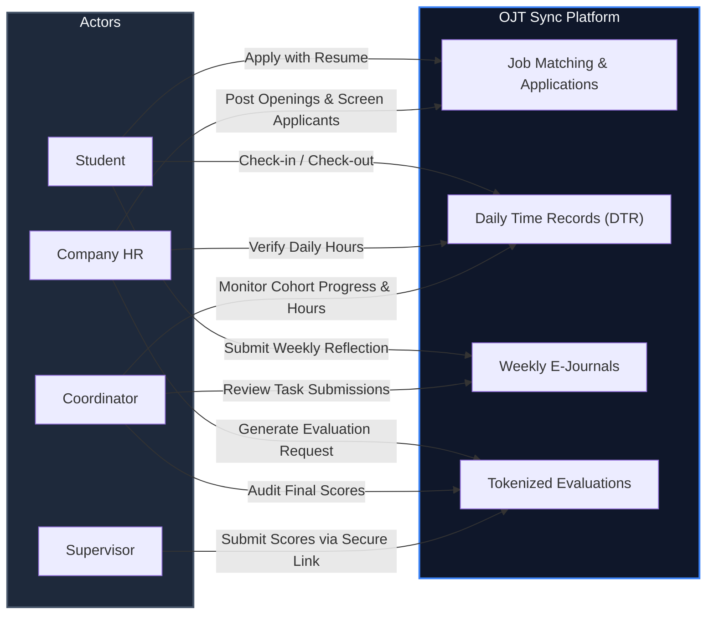

<div align="center">

# 🎓 OJT SYNC

### *Modern On-the-Job Training & Internship Management Ecosystem*

[](https://laravel.com)
[](https://php.net)
[](https://tailwindcss.com)
[](https://alpinejs.dev)
[](https://vitejs.dev)
[](LICENSE)

<br/>

**OJT Sync** streamlines and bridges the internship workflow across students, university coordinators, and partner company HR teams. From real-time daily time tracking (DTR) and e-journals to token-secured supervisor evaluations, everything is consolidated in one responsive platform.

[Key Features](#-core-capabilities) • [Role Architecture](#-role-architecture) • [Quickstart](#-quick-start) • [Demo Accounts](#-demo-credentials) • [Deployment](#-deployment)

---

</div>

## 📌 Workflow Overview



---

## ⚡ Core Capabilities

<table>
<tr>
<td width="50%" valign="top">

### 🎓 For Students
- **Smart Job Board:** Filter and apply to approved partner company internships with PDF resume attachments.
- **One-Tap DTR:** Check-in and check-out with automatic hours calculations toward the required total (default: 300 hrs).
- **Weekly E-Journals:** Record key learnings, tasks accomplished, and reflections for coordinator review.
- **Progress Tracking:** Live visual progress rings showing accredited hours versus graduation requirements.

</td>
<td width="50%" valign="top">

### 🏢 For Partner Companies (HR)
- **Vacancy Management:** Publish, update, and manage company internship listings and slot caps.
- **Applicant Pipeline:** Track candidate status across `Pending` ➔ `Shortlisted` ➔ `Interview` ➔ `Hired / Rejected` with internal interview notes.
- **DTR Verification:** One-click approval / rejection for logged intern daily time records.
- **Intern Checklists:** Track onboarding, document requirements, and deliverables for each hired intern.

</td>
</tr>
<tr>
<td width="50%" valign="top">

### 📋 For OJT Coordinators
- **Cohort Dashboard:** Real-time metrics on all registered trainees and their hours rendered.
- **Audit Logs:** Deep-dive into time logs, attached tasks, and submitted e-journal entries.
- **Company Assignment:** Direct student-to-company assignments and official status management.
- **Performance Overview:** Instant access to consolidated supervisor scoring rubrics and remarks.

</td>
<td width="50%" valign="top">

### ⭐ Token-Protected Evaluations
- **Zero-Friction Grading:** No login or supervisor account needed.
- **Single-Use Tokens:** Cryptographically signed, disposable evaluation URLs.
- **Automated Score Aggregation:** Submissions instantly compile into HR and Coordinator gradebooks.
- **Rate-Limited & Secure:** Built-in safeguards against double submissions and scraping.

</td>
</tr>
</table>

---

## 🏛 Role Architecture

```
                    ┌────────────────────────┐
                    │      System Admin      │
                                             │
                    └───────────┬────────────┘
                                │
        ┌───────────────────────┼───────────────────────┐
        ▼                       ▼                       ▼
 ┌──────────────┐        ┌──────────────┐        ┌──────────────┐
 │   Student    │        │  Company HR  │        │ Coordinator  │
 ├──────────────┤        ├──────────────┤        ├──────────────┤
 │ • Browse Jobs│        │ • Post Jobs  │        │ • Cohort DTR │
 │ • Submit App │───────►│ • Review App │        │ • E-Journals │
 │ • Time Clock │◄───────│ • Verify DTR │◄───────│ • Status     │
 │ • E-Journals │        │ • Request Eval──────┐ │ • Analytics  │
 └──────────────┘        └──────────────┘      │ └──────────────┘
                                               ▼
                                     ┌──────────────────┐
                                     │    Supervisor    │
                                     │ (Token Eval Link)│
                                     └──────────────────┘
```

---

## 🚀 Quick Start

### Prerequisites
- **PHP 8.3+** with SQLite / PostgreSQL extension enabled
- **Composer** (v2+)
- **Node.js** (v18+) & **npm**

### Installation

```bash
# 1. Clone repository
git clone https://github.com/your-username/ojt-sync.git
cd ojt-sync

# 2. Install dependencies & configure environment
composer install
cp .env.example .env
php artisan key:generate

# 3. Setup SQLite database & seed demo accounts
touch database/database.sqlite
php artisan migrate --seed

# 4. Install & bundle frontend assets
npm install
npm run build
```

### Run Locally

Launch the complete development environment (Web Server + Vite HMR + Queue Worker):

```bash
composer run dev
```

Visit [`http://localhost:8000`](http://localhost:8000) in your browser.

---

## 🔑 Demo Credentials

All seeded test accounts use the default password: `password`

| Role | Email Address | Access Scope |
| :--- | :--- | :--- |
| **🎓 Student** | `peter.parker@cvsu.edu.ph` | Intern portal, DTR clocking, journals, applications |
| **🏢 Company HR** | `hr@technologia.test` | Job postings, applicant tracker, DTR approval, evals |
| **📋 Coordinator** | `coordinator@cvsu.edu.ph` | Class overview, log auditing, company assignments |
| **🛡 Admin** | `admin@cvsu.edu.ph` | Company registration approvals & system governance |

---

## 🧪 Testing

OJT Sync includes an automated feature and unit test suite covering auth guards, applications, evaluations, and DTR calculations:

```bash
composer test
```

---

## 🌐 Deployment

The project is pre-configured with a zero-cost production template (**Render Web Service** + **Neon PostgreSQL**):

- Blueprint file: [`render.yaml`](render.yaml)
- Fully containerized via production-ready [`Dockerfile`](Dockerfile)
- Progressive Web App (PWA) ready with built-in offline service worker support

---

<div align="center">

Crafted with ❤️ for smoother college internship programs.

</div>
